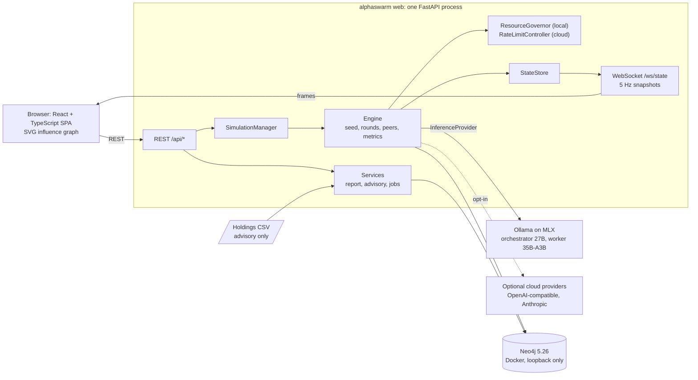

# AlphaSwarm

**A local-first simulation of how a market rumor spreads through a crowd: 100 LLM personas in 10 archetypes react to it, read each other, and move toward (or away from) consensus over two or three rounds, on one Mac.**

[](https://github.com/Avo-Sarkissian/AlphaSwarm/actions/workflows/ci.yml)
[](.github/workflows/ci.yml)
[](LICENSE)
[](https://www.python.org/downloads/)

<!-- demo:start -->
**Demo:** a static, read-only replay of one cycle, available once published. Until then, build it locally with `VITE_DEMO=1 npm --prefix frontend run build && npm --prefix frontend run preview`.
<!-- demo:end -->

Feed it a rumor such as "Apple is acquiring Anthropic for $500B". An orchestrator model extracts the companies and sectors involved; then 100 agents (institutions, sell-side analysts, event-driven funds, quants, retail degens, media narrators, algos, macro funds, short sellers and long-horizon allocators) each decide buy, sell or hold with a confidence and a rationale. From the second round on, agents read a sample of their peers' rationales and their own previous position, and decide again. Every decision, citation and influence edge lands in Neo4j, and a live graph shows the cascade as it happens.

Local-first: inference runs on your own Mac through Ollama by default, with optional cloud providers (OpenAI-compatible or Anthropic) chosen per role.

> LLM-generated simulation output for research and education; not investment advice. The report and the portfolio advisory come from language models reacting to a simulated crowd.

## Why it's interesting

- **It is built to be measured, not just animated.** A seeded control group that sees no peers can separate peer influence from noise, and a point-in-time evaluation harness compares the swarm with single-model baselines on real outcomes under pre-registered metrics. Method: [docs/methodology.md](docs/methodology.md); what has been measured so far: [Results](#results).
- **100 concurrent model calls on one laptop without swapping it to death.** Agent calls fan out through `asyncio.TaskGroup`, and a governor that reads the macOS kernel's memory signal throttles and pauses them before memory runs out ([governor.py](src/alphaswarm/governor.py), [why](docs/DECISIONS.md#adr-governor)).
- **Privacy enforced by the build, not by convention.** Portfolio holdings never reach agent prompts, Neo4j, WebSocket frames or logs; an import-linter contract and canary tests fail CI if code could leak them ([pyproject.toml](pyproject.toml), [tests/invariants/](tests/invariants/), [SECURITY.md](docs/SECURITY.md)).
- **Every run is traceable.** Each cycle stores a manifest with seeds, model digests, prompt hashes and settings ([manifest.py](src/alphaswarm/manifest.py), [why](docs/DECISIONS.md#adr-run-manifest)).
- **Model choices come from measurements.** Prefill benchmarks picked the MLX model stack, and every inference call records its prefill, decode and load times ([experiments.md](docs/experiments.md#model-stack-benchmarks-2026-06-11), [call_log.py](src/alphaswarm/inference/call_log.py)).

## Architecture



One Python process serves the API, the live WebSocket stream and the built UI, and runs one simulation at a time. The orchestrator and the worker model take turns: they are never loaded together during rounds. Module map: [docs/ARCHITECTURE.md](docs/ARCHITECTURE.md). Graph model: [docs/graph-schema.md](docs/graph-schema.md).

## Quick start

You need an Apple Silicon Mac with 64 GB of memory, Python 3.11+, [uv](https://docs.astral.sh/uv/), Node 22 (`frontend/.nvmrc`), [Docker Desktop](https://www.docker.com/products/docker-desktop/) and [Ollama](https://ollama.com/) with the MLX backend (tested with 0.30.7).

```bash
git clone https://github.com/Avo-Sarkissian/AlphaSwarm.git && cd AlphaSwarm && uv sync && npm --prefix frontend ci && npm --prefix frontend run build
./scripts/configure_ollama_app_env.sh && osascript -e 'quit app "Ollama"' && sleep 3 && open -a Ollama
ollama pull qwen3.6:35b-a3b-nvfp4 && ollama pull qwen3.6:27b-nvfp4 && ollama create alphaswarm-worker -f modelfiles/Modelfile.worker && ollama create alphaswarm-orchestrator -f modelfiles/Modelfile.orchestrator
cp .env.example .env && sed -i '' "s/^ALPHASWARM_NEO4J__PASSWORD=$/ALPHASWARM_NEO4J__PASSWORD=$(openssl rand -hex 32)/" .env && docker compose up -d --wait neo4j
uv run alphaswarm doctor && uv run alphaswarm web   # then open http://localhost:8000
```

1. Installs the Python and frontend dependencies and builds the UI (`frontend/dist/` is not committed; without it, http://localhost:8000 shows a page with the build command).
2. Gives Ollama.app the server environment AlphaSwarm needs (`OLLAMA_USE_MLX=1`, `OLLAMA_NUM_PARALLEL=4`, two loaded models) through `launchctl` plus a LaunchAgent that survives reboots, then restarts the app.
3. Downloads the two MLX models and registers the aliases the code calls.
4. Creates `.env` with a random Neo4j password and starts Neo4j on 127.0.0.1 only.
5. `doctor` checks the inference config, Neo4j, Docker, Ollama and both aliases, the MLX backend on the running server, the launchd environment, stray loaded models, the UI build and memory, and prints the fix for anything missing. The web server then applies the Neo4j schema and seeds the 100 agent nodes on startup.

### Model setup

- **Ollama.app** reads its environment from `launchctl`; `./scripts/configure_ollama_app_env.sh` sets it and installs a LaunchAgent so it survives reboots. Restart the app after running it.
- **Terminal Ollama:** run `./scripts/start_ollama.sh` instead of the app.
- **Check the MLX backend:** `grep "MLX engine initialized" ~/.ollama/logs/server.log | tail -1`. Without `OLLAMA_USE_MLX=1`, Ollama silently falls back to a much slower backend; `doctor` reports it.
- After editing a Modelfile, re-run its `ollama create` line. Details and rollback models: [docs/RUNBOOK.md](docs/RUNBOOK.md#2-models).

### Hardware and run time

<!-- runtime:start -->
| Result | Value | Source |
|---|---|---|
| Model memory (loaded, Ollama) | not measured | [Memory budget](docs/RUNBOOK.md#memory-budget): not measured yet |
| 3-round run, median wall time | not measured | [Arms](docs/experiments.md#arms): no runs recorded |
| 2-round run, median wall time | not measured | [Ablation protocol](docs/methodology.md): no runs recorded |
<!-- runtime:end -->

Per-phase memory, Neo4j caps and headroom: [RUNBOOK, memory budget](docs/RUNBOOK.md#memory-budget). On a smaller machine, use the optional cloud providers for one or both roles.

### Running it

| Command | What it does |
|---|---|
| `uv run alphaswarm web [--host 127.0.0.1] [--port 8000]` | Web UI and API (same as `uv run start`) |
| `uv run alphaswarm run "<rumor>"` | Headless run with live progress, then a report |
| `uv run alphaswarm inject "<rumor>"` | Seed only: entity extraction and persona modifiers, no rounds |
| `uv run alphaswarm report [CYCLE_ID]` | Report for a cycle (default: the latest complete one) |
| `uv run alphaswarm cycles list` / `export CYCLE_ID` / `delete CYCLE_ID` | Stored cycles; an export is a portable JSON file |
| `uv run alphaswarm doctor [--json]` | Preflight checks with fixes |

`ALPHASWARM_NUM_ROUNDS=2` runs a shorter two-round cascade. For frontend work, `npm --prefix frontend run dev` serves the UI with hot reload on http://localhost:5173 and proxies the API. To serve the UI from another host or origin, set `ALPHASWARM_ALLOWED_ORIGINS` and `ALPHASWARM_TRUSTED_HOSTS` (see `.env.example`).

### Try the advisory with example holdings

The advisory cross-references the swarm's consensus with a portfolio after each run. Without a holdings file it is skipped and the report still runs. To try it with fictional positions:

```bash
echo 'ALPHASWARM_HOLDINGS_CSV_PATH=examples/holdings.example.csv' >> .env
```

The server reads `.env` once at startup, so restart the server after appending. The file has four columns, `account,symbol,shares,cost_basis_per_share`, one row per lot. Relative paths resolve against the repository root. Holdings never reach agent prompts, Neo4j, WebSocket frames or logs.

### Optional cloud providers

Open **Settings** in the UI and pick a provider per role: local Ollama (default), any OpenAI-compatible endpoint, or Anthropic. The choice and the API keys live in `.secrets/inference.json` (owner-only permissions, gitignored, never logged or returned by the API). Cloud runs are paced to your rate limits, stop at a hard spend cap and show a cost estimate before they start. A cloud orchestrator receives held tickers for the advisory only after you turn on the opt-in in Settings, and never quantities or cost basis. File reference: [RUNBOOK, cloud mode](docs/RUNBOOK.md#cloud-mode-quick-reference).

## Results

Each row links to its protocol or its full table; a row that reads `not measured` has not been run yet, and nothing here is estimated. Measured rows come from an Apple M1 Max with 64 GB.

<!-- results:start -->
| Result | Value | Source |
|---|---|---|
| Swarm accuracy vs the best single-model baseline | not measured | [Evaluation protocol](docs/methodology.md): no runs recorded |
| Peer-attributable flip rate (treated − control) | not measured | Control group: no runs recorded |
| 2 vs 3 rounds | not measured | [Ablation protocol](docs/methodology.md): no runs recorded |
| Peer strategy: stratified vs random vs none | not measured | [Ablation protocol](docs/methodology.md): no runs recorded |
| Peer exposure before → after the selector fix | brackets never shown: 6 → 0; largest slot share: 46.0% → 15.2%; agents shown: 46 → 100 (Round 2) | [Decision](docs/DECISIONS.md#adr-diverse-peer-context) |
| Mean round time before → after the performance work | not measured | [Arms](docs/experiments.md#arms): no runs recorded |
| Worker prefill, GGUF → MLX | 833 → 2,361 tok/s (2.8×, GGUF MoE → MLX MoE) | [Model stack benchmarks](docs/experiments.md#model-stack-benchmarks-2026-06-11) |
| Orchestrator prefill, GGUF → MLX | 111 → 3,395 tok/s (30.6×, same 27B weights) | [Model stack benchmarks](docs/experiments.md#model-stack-benchmarks-2026-06-11) |
<!-- results:end -->

## How it works

1. **Seed.** The orchestrator reads the rumor, extracts the entities and writes a short modifier per bracket ([seed.py](src/alphaswarm/seed.py)). The cycle and its entities are written to Neo4j in one transaction.
2. **Round 1.** All agents decide independently: buy, sell or hold, a confidence, a sentiment and a short rationale, decoded against a JSON schema with a three-tier parse fallback ([worker.py](src/alphaswarm/worker.py)). Prices and headlines for the named tickers, from yfinance and RSS, go into the prompt as a fenced data block.
3. **Later rounds.** Agents read a seeded, bracket-diverse sample of other agents' previous rationales plus their own previous position, then decide again ([peers.py](src/alphaswarm/peers.py), [rounds.py](src/alphaswarm/rounds.py)). A seeded control group can be held out with no peers, which is how the peer effect is measured. A shock injected mid-run reaches every later round.
4. **Persist and measure.** Each round is written in one transaction: decisions, citations, rationale episodes and influence edges ([graph/](src/alphaswarm/graph/)). Flips, consensus with confidence intervals, peer exposure and per-call telemetry land on the cycle ([metrics.py](src/alphaswarm/metrics.py), [consensus.py](src/alphaswarm/consensus.py)).
5. **After the run.** A report built from the graph plus one grounded orchestrator call, the optional advisory, agent interviews, replay and a portable JSON export ([services/](src/alphaswarm/services/), [export.py](src/alphaswarm/export.py)).

Agent calls run concurrently under a `ConcurrencyController`: the memory governor locally, a token-bucket rate limiter for cloud providers.

<!-- screenshots:start -->
<!-- screenshots:end -->

## Swarm composition

The swarm models the active price-setting margin of the narrative ecosystem: who forms and spreads opinions about a rumor, not who holds the most capital. Passive index capital (it never reacts to rumors) and market makers (their honest answer is "quote both sides", which buy/sell/hold cannot express) are left out on purpose ([why](docs/DECISIONS.md#adr-swarm-composition-v2)).

<!-- brackets:start -->
| Bracket | Agents | Reach weight | Temperature | Role |
|---|---:|---:|---:|---|
| Institutions | 18 | 0.65 | 0.40 | Benchmark-bound buy-side managers; act on corroborated news, default to HOLD |
| Sell-Side | 10 | 0.75 | 0.50 | Research analysts who frame the story; lean BUY or HOLD and move fast |
| Event-Driven | 10 | 0.60 | 0.50 | Merger-arb and catalyst funds; price the odds that the event happens |
| Quants | 12 | 0.55 | 0.30 | Statistical models over narrative; HOLD without significant data |
| Degens | 15 | 0.50 | 1.10 | Leveraged retail momentum traders; rarely HOLD |
| Narrators | 8 | 0.70 | 0.90 | Media and FinTwit voices; amplify the winning story, hold no positions |
| Algos | 8 | 0.45 | 0.15 | Systematic strategies; trade only on measurable signals |
| Macro | 7 | 0.55 | 0.50 | Rates, policy and cross-asset regimes; reason about second-order effects |
| Shorts | 7 | 0.60 | 0.80 | Forensic short sellers; lean SELL on hype |
| Allocators | 5 | 0.60 | 0.40 | Decades-horizon capital; rebalance against crowd extremes |
| **Total** | **100** | | | |
<!-- brackets:end -->

Reach weight is narrative reach, how visible an agent's view is to its peers, not capital ([why](docs/DECISIONS.md#adr-influence-weight-reach)). The mix of tendencies is deliberate: four brackets lean HOLD, four lean toward acting, one leans SELL and one reasons about second-order effects.

## Design decisions

- **Local-first inference, cloud strictly opt-in** ([decision](docs/DECISIONS.md#adr-local-first-inference)).
- **At most two models loaded; orchestrator and worker take turns** ([decision](docs/DECISIONS.md#adr-sequential-model-lifecycle)).
- **A narrative-ecosystem swarm with deliberate exclusions** ([decision](docs/DECISIONS.md#adr-swarm-composition-v2)).
- **Peers sampled per reader with bracket diversity and a seeded shuffle** ([decision](docs/DECISIONS.md#adr-diverse-peer-context)).
- **A deterministic graph layout instead of a physics simulation** ([decision](docs/DECISIONS.md#kr-41-1-01)).
- **Holdings isolation enforced by import contracts** ([decision](docs/DECISIONS.md#adr-holdings-isolation)).
- **A run manifest on every cycle** ([decision](docs/DECISIONS.md#adr-run-manifest)).
- **Schema-constrained decoding with a three-tier parse fallback** ([decision](docs/DECISIONS.md#adr-structured-output)).
- **WebSocket frames at 5 Hz, sent on change, with latest-wins client queues** ([decision](docs/DECISIONS.md#adr-ws-broadcaster)).
- **A hero graph that answers "who influenced whom"** ([decision](docs/DECISIONS.md#adr-hero-graph)).
- **A portable cycle export with no holdings in it** ([decision](docs/DECISIONS.md#adr-cycle-export)).

Every decision, including the ones later revised, is in [docs/DECISIONS.md](docs/DECISIONS.md).

## Testing & CI

<!-- quality:start -->
| Result | Value | Source |
|---|---|---|
| Backend tests (offline + Neo4j) | 4,037 | [Test suite](docs/experiments.md#test-suite-v60) |
| Backend coverage (line + branch, offline suite) | 95.5% | [Test suite](docs/experiments.md#test-suite-v60) |
| Frontend tests (vitest) | 881 | [Test suite](docs/experiments.md#test-suite-v60) |
| Import-linter contracts kept | 5 | [Test suite](docs/experiments.md#test-suite-v60) |
<!-- quality:end -->

The CI and coverage-gate badges at the top of this page track `master`. CI runs four jobs on every push: **lint** (ruff, ruff format, mypy strict, import-linter, vulture), **backend-unit** (the offline suite with a coverage gate), **backend-neo4j** (graph tests and golden read models against a throwaway Neo4j) and **frontend** (ESLint, knip, vitest and the production build). Live-network tests run nightly. Locally:

```bash
uv run pytest -q -m "not neo4j"                                      # offline suite
scripts/neo4j_test.sh up && uv run pytest -q -m neo4j --require-neo4j  # throwaway Neo4j on 127.0.0.1:7688
npm --prefix frontend run lint && npm --prefix frontend test && npm --prefix frontend run build
```

The Neo4j tests refuse to start against the development database. Frontend testing notes: [frontend/TESTING.md](frontend/TESTING.md).

## Security

Threat model, mitigations and known limitations: [docs/SECURITY.md](docs/SECURITY.md). In short:

- Neo4j listens on 127.0.0.1 only and has a per-install password; nothing in the repository holds a credential.
- Every request and the WebSocket are checked against the allowed hosts, and state-changing routes and the WebSocket check the Origin header.
- Untrusted text (RSS headlines, peer rationales) is sanitized and fenced in the user message, never placed in the system role.
- API keys live in an owner-only file and are redacted from logs.
- Portfolio data is isolated as described above and reaches a cloud model only after an explicit opt-in.

## Limitations

- **A simulation, not a market.** Signals are opinions, not trades, and two real participant groups are excluded on purpose (see Swarm composition).
- **Public information only.** Agents see the rumor, injected shocks, public prices and headlines, and their peers; there is no private information.
- **Small samples.** The evaluation set and the seed counts are small; [docs/methodology.md](docs/methodology.md) states the sizes and the pre-registered metrics.
- **Not bit-exact.** Seeds make peer selection and control assignment repeatable, but batched decoding on a local server is not bit-exact, so reruns can differ in a few decisions.
- **Hardware.** The local path needs a 64 GB Apple Silicon Mac; smaller machines need the cloud path for at least one role.
- **Single user.** There is no authentication; keep the server on loopback.

## Roadmap

Data sources today: yfinance prices and Google News and Yahoo Finance RSS headlines ([ingestion/](src/alphaswarm/ingestion/)). Planned, not built:

- SEC filings and earnings-call transcripts as point-in-time context providers.
- A larger, out-of-sample event set for the evaluation.
- A Linux and NVIDIA profile for local inference (the memory signal and the model stack are macOS and MLX today).

Open defects and ideas: [docs/BACKLOG.md](docs/BACKLOG.md).

## Engineering process

AlphaSwarm is a solo project built with AI coding assistants. I set the architecture, the swarm design, the privacy model and the recorded decisions in [docs/DECISIONS.md](docs/DECISIONS.md); the assistants drafted much of the code and the tests under plans I reviewed. Changes land with tests, CI gates lint, types, import contracts, coverage and golden tests, and an October 2026 audit of the whole system drove the work listed in [CHANGELOG.md](CHANGELOG.md). The mistakes are written down too: agent merges once deleted large amounts of work, which is why I check the diffstat of every agent merge before trusting it ([lessons](docs/HISTORY.md#lessons-worth-keeping)).

## License

MIT. See [LICENSE](LICENSE). Release history: [CHANGELOG.md](CHANGELOG.md).
