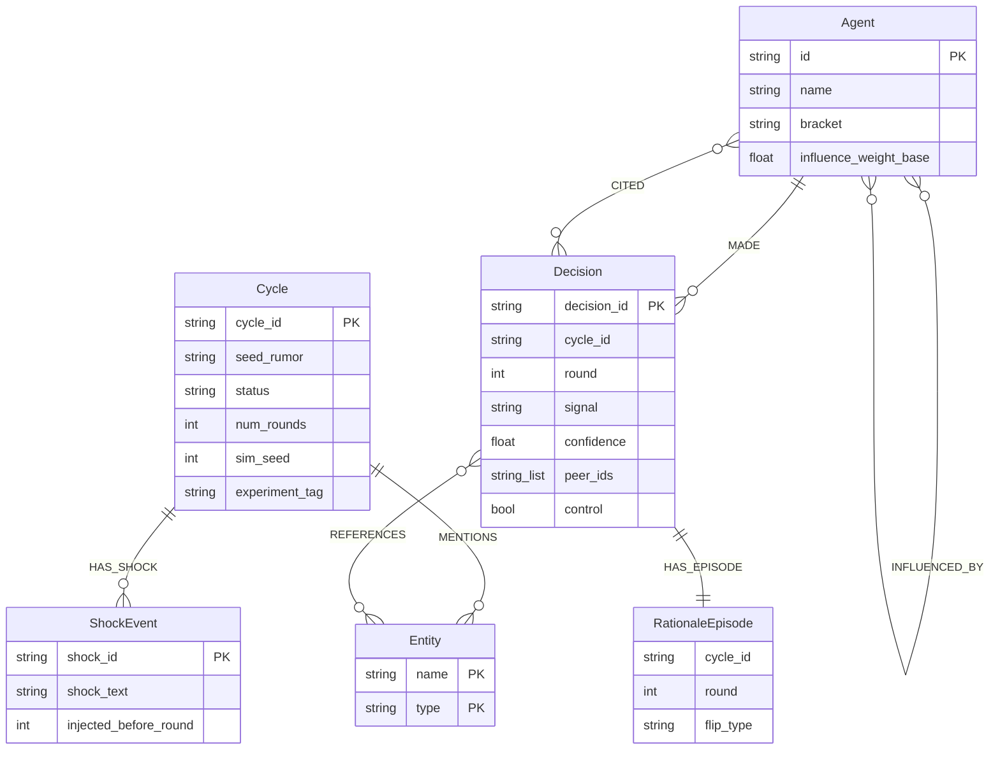

# Graph schema

What AlphaSwarm writes to Neo4j, as of v6.0. `tests/test_graph_schema_doc.py` checks
this page against the Cypher in `src/alphaswarm/`: a node label, relationship type or
schema statement the code writes but this page leaves out, or one listed here that the
code no longer writes, fails the suite. Why the model looks like this:
[DECISIONS.md#adr-neo4j-schema](DECISIONS.md#adr-neo4j-schema).

A Decision belongs to its cycle through the indexed `cycle_id` property, not through a
relationship. The 100 Agent nodes are shared by every cycle; everything that is
specific to one cycle lives on Decision, RationaleEpisode, ShockEvent and the
`MENTIONS` and `INFLUENCED_BY` edges. Signals are stored lowercase (`buy`, `sell`,
`hold`, `parse_error`). Neo4j stores no nulls: a property shown as "absent" below was
not recorded for that node.

All writers are in `src/alphaswarm/graph/schema_writes.py`.

## Nodes

### Cycle

| Property | Type | Written by | Meaning |
|---|---|---|---|
| `cycle_id` | string (UUID4) | `create_cycle_with_seed_event` | Primary key |
| `seed_rumor` | string | `create_cycle_with_seed_event` | The rumor as submitted |
| `overall_sentiment` | float | `create_cycle_with_seed_event` | The orchestrator's sentiment for the rumor, -1 to 1 |
| `created_at` | datetime | `create_cycle_with_seed_event` | Creation time |
| `status` | string | `create_cycle_with_seed_event`, `set_cycle_status` | `running`, `complete`, `failed` or `cancelled` |
| `error_code` | string, or absent | `set_cycle_status` | Why a failed cycle failed (a `RunErrorCode`); removed by any other status |
| `num_rounds` | int | `create_cycle_with_seed_event` | Rounds configured for the run |
| `modifiers_json` | string (JSON), or absent | `create_cycle_with_seed_event` | Per-bracket persona focus lines for this cycle |
| `prompt_template_hash` | string (sha256), or absent | `create_cycle_with_seed_event` | Hash of the prompt templates |
| `run_manifest_json` | string (JSON) | `write_run_manifest` | The run manifest: models, digests, prompt hashes, settings, seeds |
| `sim_seed` | int | `write_run_manifest` | Seed for peer sampling, control assignment and call seeds |
| `experiment_tag` | string, or absent | `write_run_manifest` | Label that groups runs for comparison |
| metric keys | scalars | `write_cycle_metrics` | Flat per-round and per-run metrics (`r{n}_*`, totals); see [adr-cycle-metrics](DECISIONS.md#adr-cycle-metrics) |
| `metrics_recorded_at` | datetime | `write_cycle_metrics` | When the metrics were written |

### Agent

| Property | Type | Written by | Meaning |
|---|---|---|---|
| `id` | string | `seed_agents` (run by `ensure_schema`) | Primary key, for example `sell_side_03` |
| `name` | string | `seed_agents` | Display name, for example `Sell-Side 3` |
| `bracket` | string | `seed_agents` | `BracketType` value |
| `risk_profile` | float | `seed_agents` | Bracket risk profile, 0 to 1 |
| `temperature` | float | `seed_agents` | Sampling temperature of the bracket |
| `influence_weight_base` | float | `seed_agents` | Narrative reach, not capital ([adr-influence-weight-reach](DECISIONS.md#adr-influence-weight-reach)) |

`seed_agents` also deletes Agent nodes that are no longer in the roster, but only those
that never made a decision, so past cycles keep their authors.

### Decision

| Property | Type | Written by | Meaning |
|---|---|---|---|
| `decision_id` | string (UUID4) | `persist_round` | Primary key |
| `cycle_id`, `round` | string, int | `persist_round` | Which cycle and round |
| `signal` | string | `persist_round` | `buy`, `sell`, `hold` or `parse_error` |
| `confidence`, `sentiment` | float | `persist_round` | 0 to 1, and -1 to 1 |
| `rationale` | string | `persist_round` | The agent's public rationale |
| `error_kind` | string, or absent | `persist_round` | `inference`, `parse` or `truncated` for failed decisions |
| `parse_tier` | int, or absent | `persist_round` | Which parse tier produced the decision |
| `peer_ids` | list of strings, or absent | `persist_round` | Peers the agent was shown, in display order; empty for an agent shown none |
| `control` | bool | `persist_round` | The agent was in the no-peer control group |
| `citations_invalid` | int, or absent | `persist_round` | Citations dropped because the agent had not been shown that peer |
| `shock_treated` | bool, or absent | `persist_round` | Only with the shock treatment split: the agent saw the shock |
| `narrative` | string, or absent | `write_decision_narrative` | Final round only; generated on the agent's first interview |

### RationaleEpisode

| Property | Type | Written by | Meaning |
|---|---|---|---|
| `cycle_id`, `round` | string, int | `persist_round` | Which cycle and round |
| `peer_context_received` | string, or absent | `persist_round` | The peer block the agent saw |
| `flip_type` | string | `persist_round` | How the signal changed from the previous round (`none`, `buy_to_sell`, ...) |
| `timestamp` | datetime | `persist_round` | Write time |

### Entity

| Property | Type | Written by | Meaning |
|---|---|---|---|
| `name`, `type` | string, string | `create_cycle_with_seed_event` | Composite key: a company, sector or person the rumor names |

### ShockEvent

| Property | Type | Written by | Meaning |
|---|---|---|---|
| `shock_id` | string (UUID4) | `write_shock_event` | Primary key |
| `shock_text` | string | `write_shock_event` | The injected news |
| `injected_before_round` | int | `write_shock_event` | First round that saw it (later rounds keep it) |
| `created_at` | datetime | `write_shock_event` | Write time |

## Relationships

| Pattern | Properties | Meaning |
|---|---|---|
| `(Cycle)-[:MENTIONS]->(Entity)` | `relevance`, `sentiment`, `ticker` | Entities the orchestrator extracted from the rumor; the resolved ticker is per cycle ([adr-ticker-resolution](DECISIONS.md#adr-ticker-resolution)) |
| `(Cycle)-[:HAS_SHOCK]->(ShockEvent)` | none | Shocks injected during the run |
| `(Agent)-[:MADE]->(Decision)` | none | Who made the decision |
| `(Decision)-[:CITED]->(Agent)` | none | Peers the decision cites, filtered to the peers the agent was shown |
| `(Decision)-[:HAS_EPISODE]->(RationaleEpisode)` | none | The decision's rationale episode |
| `(Decision)-[:REFERENCES]->(Entity)` | `match_type` | Entities of the decision's own cycle that the rationale names (whole-token matches) |
| `(Agent)-[:INFLUENCED_BY]->(Agent)` | `weight`, `cycle_id`, `round` | From the citing agent to the cited agent, one edge per round ([p8-d-01](DECISIONS.md#p8-d-01)) |

## Schema statements

`SCHEMA_STATEMENTS` in `src/alphaswarm/graph/schema_writes.py`, applied by
`ensure_schema()`. All are `IF NOT EXISTS` or `DROP … IF EXISTS`, so there is no
migration framework, and the step deletes no data.

| Name | Kind | On |
|---|---|---|
| `agent_id_unique` | uniqueness constraint | `Agent.id` |
| `cycle_id_unique` | uniqueness constraint | `Cycle.cycle_id` |
| `entity_name_type_unique` | uniqueness constraint | `(Entity.name, Entity.type)` |
| `shock_id_unique` | uniqueness constraint | `ShockEvent.shock_id` |
| `decision_id_unique` | uniqueness constraint | `Decision.decision_id` |
| `decision_cycle_round` | index | `(Decision.cycle_id, Decision.round)` |
| `decision_cycle` | index | `Decision.cycle_id` |
| `cycle_status` | index | `Cycle.status` |
| `cycle_created` | index | `Cycle.created_at` |
| `cycle_experiment_tag` | index | `Cycle.experiment_tag` |
| `influenced_by_cycle_round` | relationship index | `(INFLUENCED_BY.cycle_id, INFLUENCED_BY.round)` |

While duplicate decision ids exist (older databases), `ensure_schema` keeps the plain
`decision_id_idx` index on `Decision.decision_id` instead of `decision_id_unique` and
logs a warning; otherwise it drops `decision_id_idx`. Also dropped when present:
`agent_id_idx`, `post_cycle_round`, `post_id_idx`, `episode_cycle_round`.

After the statements, `ensure_schema` gives status-less legacy cycles a status
(`complete` or `failed`) and seeds the Agent nodes.

## No longer written

Older cycles may still hold these; no reader depends on them: `Post` nodes with
`AUTHORED`, `HAS_POST` and `READ_POST`, `(Decision)-[:FOR]->(Cycle)`,
`RationaleEpisode.rationale` (readers use `Decision.rationale`) and
`Agent.decision_narrative` (now `Decision.narrative`, [p11-d-10](DECISIONS.md#p11-d-10)).
`remove_legacy_properties()` removes the last one; it never runs at startup, so take a
backup first ([RUNBOOK.md](RUNBOOK.md)). `delete_cycle` also removes a cycle's legacy
`Post` nodes.
